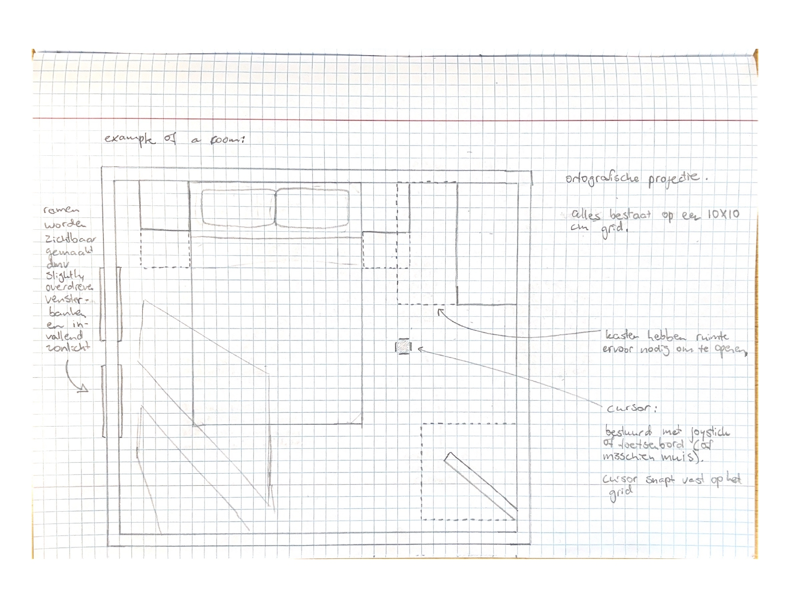
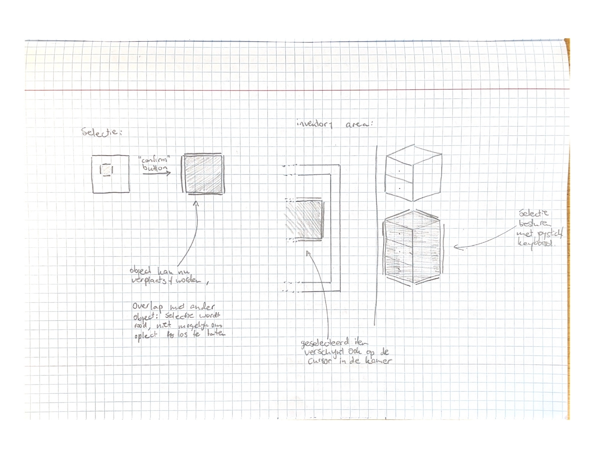
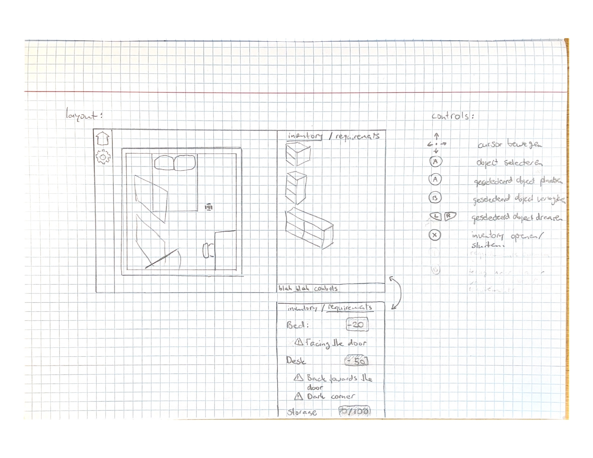

# Projectvoorstel
Remus van der Vossen

Mijn plan is om een cozy puzzle game te maken, waar het doel is om kamers in te richten gebaseerd op Feng Shui principes. De speler moet hierbij rekening houden met de vorm van de lege kamer, en de locaties van de deuren en ramen. 

Dit project is gericht op casual gamers en mensen met een interesse in interieurinrichting. Het zal dus vooral op handheld consoles, laptops of tablets gespeeld worden. Omdat ik dit spel zelf het liefst met een controller zou spelen, zal ik vooral hiervoor developen.

Ik ben nog geen puzzle game tegen gekomen met een vergelijkbaar thema, dus ik verwacht dat mijn idee hier een unieke niche inneemt.

Voor dit project zal ik in eerste instante focussen op slaapkamers, en de "correcte" locatie van een bed. In Feng Shui zijn er bepaalde "regels" voor het plaatsen van een bed (plaats het bed tegen een muur, niet met je hoofd tegen het raam, niet met je voeten richting de deur, etc.). Op basis van dit soort regels krijgt de layout een score, en het is de bedoeling om deze hoog genoeg te krijgen.

<!-- Meubels kunnen geplaatst worden op een grid, waar de vakjes $10\times10$ cm groot zijn.  -->

### Features:
#### Essentieel:
- Controller/Keyboard inputs
- Kamers met deuren en ramen
- Verplaatsbare en draaibare meubels op een grid (bed, nachtkastje, kledingkast)
- Inventory area voor beschikbare meubels
- Collision detectie tussen meubels en muren/andere meubels
- Scoring systeem voor plaatsing van het bed

#### Extra:
- Edit history en undo button
- Muis/touchscreen support
- Meer soorten meubels en kamers met eigen scoringsregels (bureau, bank, eettafel)
- Uitgebreider scoring systeem
    - Extra punten voor meer opslagruimte (?)
    - Extra punten voor opener layout  (?)

